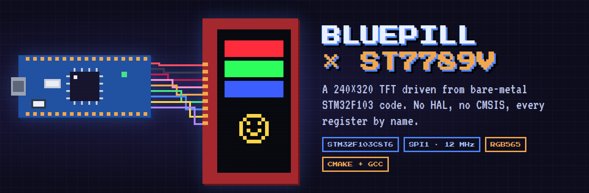
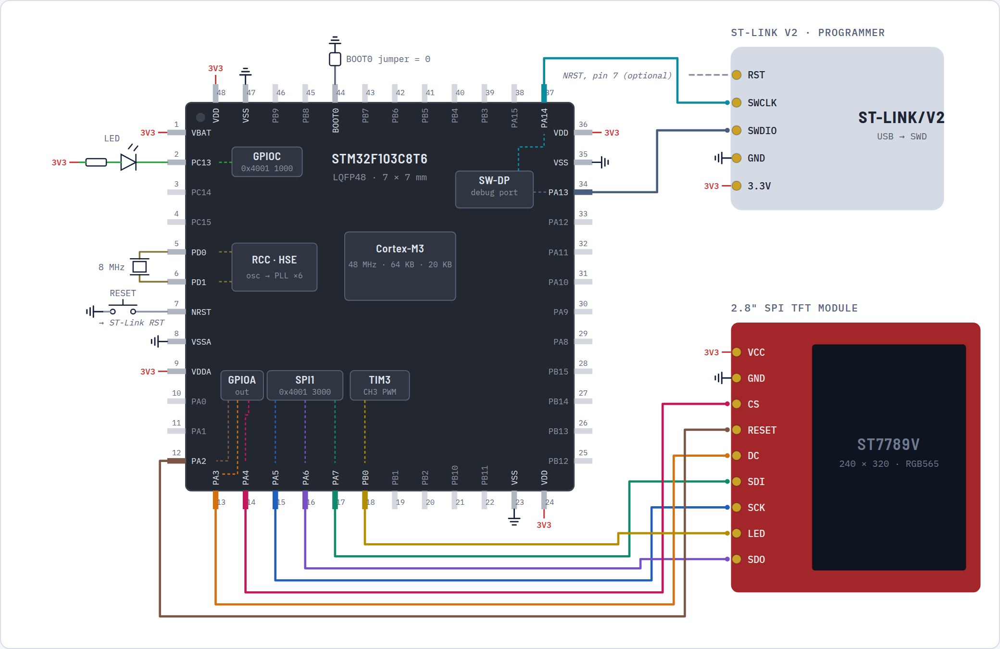
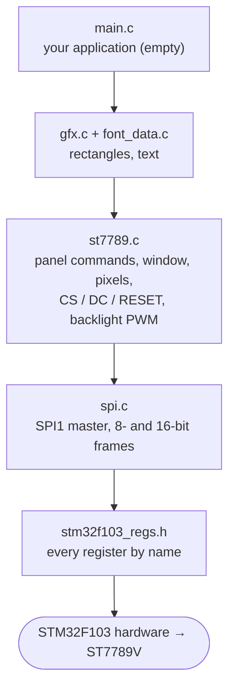
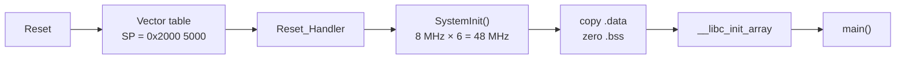

<p align="center">
  
</p>

<p align="center">
  
  
  
  
  <a href="lcd_01_hello_world/LICENSE"></a>
</p>

<p align="center">
  <a href="#-getting-started"><b>Getting started</b></a> ·
  <a href="docs/windows-setup.md"><b>Windows guide</b></a> ·
  <a href="#-wiring"><b>Wiring</b></a> ·
  <a href="#-how-the-code-is-organised"><b>Architecture</b></a> ·
  <a href="#-status"><b>Status</b></a> ·
  <a href="#-starting-a-new-claude-code-session-on-a-fresh-clone"><b>For Claude Code sessions</b></a> ·
  <a href="https://emersonandrey11.github.io/bareMetalQuest/"><b>Play the game</b></a>
</p>

---

<p align="center">
  <picture>
    <source media="(prefers-color-scheme: dark)" srcset="docs/wiring-dark.png">
    
  </picture>
  <br>
  <sub>Every package pin of the STM32F103C8T6 and the peripheral behind it. An interactive version, where hovering a wire shows its register settings, is in <code>lcd_01_hello_world/docs/project-structure.html</code>.</sub>
</p>

Learning to drive a 2.8" **ST7789V 240×320 TFT** from an **STM32F103C8T6 "Blue Pill"** the hard way: no HAL, no CMSIS, no CubeMX-generated code. Every register is written by name, every wait loop has a timeout, and the comments explain why, citing the reference manual.

The first project, [`lcd_01_hello_world/`](lcd_01_hello_world/), contains the whole foundation: start-up code, a 48 MHz clock, a 1 ms SysTick, an SPI1 driver, an ST7789V panel driver and a small graphics layer with bitmap fonts. **`main.c` is empty on purpose:** writing the first application is the exercise.

## 📦 What's inside

```text
.
├── README.md                     you are here
├── docs/
│   ├── banner.png                the image above
│   └── architecture-game.html    Bare Metal Quest: the architecture as a retro game
└── lcd_01_hello_world/           project 1: the foundation
    ├── CLAUDE.md                 project notes: commands, architecture, conventions (read this first)
    ├── HARDWARE.md               wiring
    ├── Src/                      main.c, st7789.c, spi.c, gfx.c, font_data.c, clock.c, timebase.c, startup, newlib stubs
    ├── Inc/                      stm32f103_regs.h (register map), board.h (pins, clocks), one header per driver
    ├── stm32f103x8_flash.ld      linker script: 64 KB flash at 0x0800 0000, 20 KB RAM
    ├── CMakeLists.txt            add new source files here
    ├── CMakePresets.json, cmake/ Debug and Release presets (cmake/ is managed by the STM32Cube extension)
    ├── flash.sh, flash.ps1       build and flash over ST-Link (Linux, Windows)
    ├── openocd.py                OpenOCD tutorial and live register inspector (tkinter)
    ├── tools/gen_font.py         regenerates the bitmap fonts
    └── docs/project-structure.html  interactive map of the project, incl. a pin-level wiring diagram
```

## 🔌 Wiring

| TFT pin | Blue Pill | Driven by | Pin mode |
| --- | --- | --- | --- |
| SCK | **PA5** | SPI1_SCK | alternate function push-pull, 50 MHz |
| SDI (MOSI) | **PA7** | SPI1_MOSI | alternate function push-pull, 50 MHz |
| SDO (MISO) | **PA6** | SPI1_MISO (only to read the panel ID) | input, pull-down |
| CS | **PA4** | GPIO, active low | output, 50 MHz |
| DC | **PA3** | GPIO, low = command, high = data | output, 50 MHz |
| RESET | **PA2** | GPIO, active low | output, 2 MHz |
| LED | **PB0** | TIM3_CH3 PWM, 20 kHz (backlight) | alternate function push-pull, 2 MHz |
| VCC · GND | 3.3 V · GND | | |

ST-Link V2: **SWDIO → PA13**, **SWCLK → PA14**, GND, and 3.3 V only if the board isn't powered over USB.

> [!TIP]
> Clone the repo and open `lcd_01_hello_world/docs/project-structure.html` in a browser for an interactive version: hover any wire to see the register value that configures it.

## 🚀 Getting started

> [!NOTE]
> **On Windows?** Follow the step-by-step guide **[docs/windows-setup.md](docs/windows-setup.md)**: driver, tools, build and three ways to flash, including connect under reset. The commands below are for Linux.

**You need:** the board, the TFT module and an ST-Link V2; the STM32Cube extension for VS Code (it installs the GNU Arm toolchain, CMake and Ninja); `st-flash` or OpenOCD (`sudo apt install stlink-tools openocd`); and Python 3 with tkinter for `openocd.py`.

```bash
git clone https://github.com/Emersonandrey11/BluePill_ST7789V_240x320_TFT.git
cd BluePill_ST7789V_240x320_TFT/lcd_01_hello_world
./flash.sh                 # builds the Debug image and flashes it at 0x0800 0000
```

To build without flashing, put the toolchain on `PATH` first. `flash.sh` does it for you with the STM32Cube extension's folders, and lines 12–13 show them.

```bash
cmake --preset Debug && cmake --build --preset Debug   # -> build/Debug/lcd.elf
python3 openocd.py                                     # inspect the chip live through the ST-Link
```

The build must finish without warnings (`-Wall -Wextra -Wpedantic`). There are no automated tests: behaviour is checked on the hardware.

## 🧱 How the code is organised

Calls only go down. `board.h` (pins, clocks) and `timebase.c` (`millis()`, `delay_ms()`) are shared by every layer.



What runs before `main()`:



> [!IMPORTANT]
> SysTick is **not** running when `main()` starts. Call `timebase_init()` first, or `delay_ms()` waits forever, and `lcd_init()` needs it for the panel's reset timing.

## 📊 Status

| | |
| --- | --- |
| ✅ Builds | clean, no warnings: 1,056 B of 64 KB flash, 1,984 B of 20 KB RAM (with `main.c` empty) |
| ⚠️ On hardware | **not verified yet**: on 2026-11-22 the board did not answer on SWD (`init mode failed`), so nothing has been flashed since the project was cut down from an older MPU6050 project |
| ⚠️ `openocd.py` | tested against a simulated OpenOCD only |
| ⚠️ TFT header order | taken from the common red 2.8" SPI module; check your module's silkscreen |
| 📝 `main.c` | empty on purpose: the next step is yours |

## 🤖 Starting a new Claude Code session on a fresh clone

A new Claude Code session knows nothing about earlier ones: its memory stays on the machine and in the folder where it was created. Everything a new session needs is in this repository, so it only has to be pointed at the right files.

**1. Clone and start Claude Code at the repository root**, and keep using that same folder for later sessions. Claude Code ties its memory to the folder a session starts in, and future `lcd_0N_*` projects go next to `lcd_01_hello_world/`.

```bash
git clone https://github.com/Emersonandrey11/BluePill_ST7789V_240x320_TFT.git
cd BluePill_ST7789V_240x320_TFT
claude
```

**2. Paste this as the first message:**

```text
This is a fresh clone of BluePill_ST7789V_240x320_TFT. Before changing anything:
1. Read README.md (sections "Status" and "Starting a new Claude Code session")
   and lcd_01_hello_world/CLAUDE.md.
2. I am learning bare-metal STM32. Explain the hardware and registers; do not
   write main.c or peripheral set-up for me unless I ask.
3. Check the toolchain and build: in lcd_01_hello_world run
   cmake --preset Debug && cmake --build --preset Debug.
   If a tool is missing, tell me what to install instead of working around it.
4. Do not commit or push unless I ask.
Then summarise the project in five lines and wait for my next request.
```

**3. The house rules** every session must follow, also written in [`lcd_01_hello_world/CLAUDE.md`](lcd_01_hello_world/CLAUDE.md):

| Rule | Why |
| --- | --- |
| `main.c` and peripheral configuration belong to the person | the project is a learning exercise |
| Every register access goes through a name in `Inc/stm32f103_regs.h`; add missing ones there | readable, checkable against RM0008 |
| Every wait loop has a timeout; functions return `0` or `-1` | a missing wire must not hang the chip |
| Zero warnings with `-Wall -Wextra -Wpedantic` | the only static check the project has |
| Clock constants in `board.h` change together with `clock.c` | SPI speed, PWM and the 1 ms tick derive from them |
| Don't edit `cmake/flags.cmake`, `cmake/files.cmake`, `project-description.json` by hand | the STM32Cube extension manages them |
| Regenerate `font_data.c` / `font.h` with `tools/gen_font.py`; don't edit them | generated files |
| Never commit tokens or credentials; `GITHUB.md` is a local-only file and is not in this repository | the repository is public |
| Commit and push only when asked | the person reviews every change |

**4. On a new computer**, install the prerequisites from [Getting started](#-getting-started) first. `flash.sh` expects the STM32Cube bundle versions installed on the original machine (`gnu-tools-for-stm32 14.3.1+st.2`, `cmake 4.4.0+st.1`, `ninja 1.13.2+st.1`). If yours differ, update those paths, or let the session do it after you confirm.

## 🕹️ Bare Metal Quest

The architecture of this project, as a retro arcade game in six stages: boot the chip, stack the drivers, drive the SPI bus bit by bit, wire the TFT, and beat a boss that pitches constraint-breaking changes.

**[▶ Play it online](https://emersonandrey11.github.io/bareMetalQuest/)**, or open [`docs/architecture-game.html`](docs/architecture-game.html) locally. The full version lives in [Emersonandrey11/bareMetalQuest](https://github.com/Emersonandrey11/bareMetalQuest).

## 📄 License

[MIT](lcd_01_hello_world/LICENSE). Files supplied by STMicroelectronics (start-up code, newlib stubs, linker script) keep their own terms, listed in that file.
